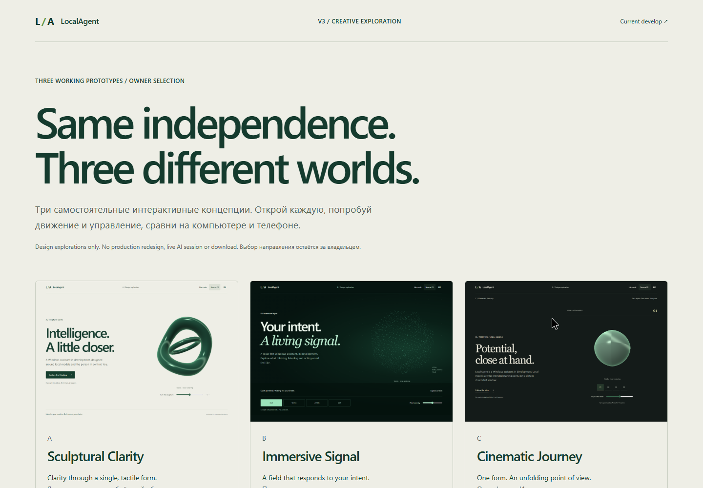

# LocalAgent Site V3 · Owner selection

**30 Oct direction update:** green Immersive Signal is now the priority. [Open the new B](concept-b-immersive/) / [current evidence and limits](concept-b-immersive/README.md). A remains clean; C now uses green lighting. Earlier captures and measurements below are historical snapshots, not a fresh verification of this revision. Production remains owner-gated.

Stage **#12 only**, parent #11. Base: `develop` at `9ad380ee1f7b0d828db03afb489a494968502668`. No direction has been selected. Issues #13–17 remain blocked. This is not a production engine or a redesigned release.

## Open all three working prototypes

From the repository root, with Python 3:

```sh
python experiments/site-v3/preview.py --open
```

The gallery opens at **http://127.0.0.1:8770/experiments/site-v3/**. The server binds loopback only, serves this public website checkout and shuts down after 30 minutes (or Ctrl+C). Use `--port 8771` if the port is occupied, or `--minutes 60` for a longer owner review. No package installation, build, account or external service is needed. Do not open the individual HTML files via `file://`: their locally served ES modules require HTTP.

- [A — Sculptural Clarity](concept-a/): a quiet light composition, interlocking raymarched sculpture, tactile inspection and interactive product principles.
- [B — Immersive Signal](concept-b/): a deep-green spatial field, four morphing particle behaviors, field-intensity control and a reversible permission simulation.
- [C — Cinematic Journey](concept-c/): an editorial four-chapter story, one evolving 3D form, native scrolling and chapter navigation.
- [Interactive comparison gallery](index.html): all three, recorded motion, qualitative decision matrix and current develop baseline.

Каждый вариант содержит Hero и связанный интерактивный экран / историю. Текст объясняет Windows, локальные модели, контроль человека и статус разработки. Все действия — симуляции; голос, файлы и ИИ не подключены. Никакого скачивания продукта или обещания релиза.

## Before / after and motion

These are actual Chrome captures. Still screenshots pause decorative animation; videos show live rendering and interactions. All dimensions are CSS pixels. Default EN, plus RU mobile captures.

| View | Current develop | A | B | C |
|---|---|---|---|---|
| 1440 desktop | [Before](evidence/before-desktop-1440.png) | [A](evidence/a-desktop-1440.png) | [B](evidence/b-desktop-1440.png) | [C](evidence/c-desktop-1440.png) |
| 1920 desktop | [Before](evidence/before-desktop-1920.png) | [A](evidence/a-desktop-1920.png) | [B](evidence/b-desktop-1920.png) | [C](evidence/c-desktop-1920.png) |
| 390 mobile | [Before](evidence/before-mobile-390.png) | [A](evidence/a-mobile-390.png) | [B](evidence/b-mobile-390.png) | [C](evidence/c-mobile-390.png) |
| 430 mobile | [Before](evidence/before-mobile-430.png) | [A](evidence/a-mobile-430.png) | [B](evidence/b-mobile-430.png) | [C](evidence/c-mobile-430.png) |
| RU mobile | — | [A](evidence/a-ru-mobile.png) | [B](evidence/b-ru-mobile.png) | [C](evidence/c-ru-mobile.png) |
| Second screen | — | [A](evidence/a-second-screen.png) | [B](evidence/b-second-screen.png) | [C](evidence/c-second-screen.png) |
| Motion recording | — | [MP4](evidence/a-motion.mp4) | [MP4](evidence/b-motion.mp4) | [MP4](evidence/c-motion.mp4) |
| Forced WebGL fallback | — | [A](evidence/a-fallback.png) | [B](evidence/b-fallback.png) | [C](evidence/c-fallback.png) |



## Decision matrix

Qualitative trade-offs; these are **not GPU benchmarks or objective aesthetic scores**.

| Criterion | A · Sculptural Clarity | B · Immersive Signal | C · Cinematic Journey |
|---|---|---|---|
| Visual originality | Signature tactile interlocking form, quiet light identity | Spatial field as a responsive instrument; greater risk of familiar AI-sphere imagery | A changing object as a visual argument; editorial rhythm |
| User comprehension | Most immediate: one sentence, one destination, explorable principles | State descriptions must keep the atmosphere grounded in a product | Strongest unfolding explanation, but asks visitors to scroll |
| Performance cost | Medium: up to 68 SDF steps per fragment | Low–medium: 1,800 mobile / 3,400 desktop points, additive blending | Medium: SDF plus native scroll updates; more layout coordination |
| Accessibility | Simple DOM order, named range, keyboard principle buttons | Named state buttons, live descriptions, reversible simulation | Native anchors and complete text with motion disabled |
| Mobile quality | Stacked, clear, spacious; inspection range below sculpture | Field retains depth; mode panel is below the first fold | Compact pinned form; deliberate loss of desktop scale |
| Implementation risk | Lowest interaction complexity | Mode contrast, particle legibility and overdraw need refinement | Highest: choreography, sticky layout, content length and device QA |
| Maintenance cost | Smallest state surface | State/copy synchronization | Chapter/shape/content coupling |

**Recommendation by priority:** A for immediate product clarity; B for an expressive living-intelligence impression; C for a slower narrative reveal. None is automatically preferred. The next step is an explicit owner decision: **A, B, C or requested revisions**, with this PR/SHA and notes in #11. No implementation stages are authorized by this delivery.

## Technology and safeguards

Native WebGL 1 + original GLSL and SVG. No Three.js/GSAP or new runtime dependencies. A/C use a full-screen raymarch shader; B uses a deterministic spatial point buffer and different vertex behavior for each mode. Sharing only the low-level render lifecycle and controls avoids installing three engines, while layouts, geometry, typography, interactions and narrative remain different.

- Rendering is capped near 30 draws/second, DPR 1.5 and approximately 1.05 million pixels. This intentionally favors an exploration's bounded cost over a claimed 60fps production target.
- Pause and OS reduced-motion stop the render loop. Under reduced motion C does not scrub its object or pin its scene; its entire story remains readable.
- Intersection/visibility gates stop background motion. A/B offscreen rendering was also measured at zero calls during a short check.
- WebGL absence/context loss, manual Lite mode, <=4GB reported memory or <=4 reported logical processors select a static original SVG. A user can explicitly try 3D on a device that defaults to Lite. Unreported device metrics default to attempting WebGL.
- Without JavaScript all content, SVGs and native links remain; dead script-only controls are hidden. EN is the static default; the no-script notice is bilingual.
- No requests to AI, microphone, filesystem, analytics or remote visual services. Fonts are system fallbacks. [Asset/dependency provenance](LICENSES.md).

## Verification actually performed

- `npm run check`: **18/18** (15 existing tests + 3 new policy tests). `npm run build` passes. The production allow-list and workflow files are unchanged; no prototype files enter `dist`.
- Playwright real Chrome, all **36 viewport/locale cases**: three concepts × 360/390/430/768/1440/1920 × EN/RU. No horizontal overflow, clipped checked heading/body/control elements, or WebGL errors.
- A principle selection, keyboard Enter and range ArrowRight. B all four states, permission simulation and reversal. C native chapter links. Separate mobile context: touch language controls and scene input for all three, B touch mode switching.
- Manual pause/reduced-motion validated with identical Canvas pixel captures after 200ms. Lite mode and restoration tested. Forced no-WebGL, low-memory and JS-disabled contexts tested for all three. WebGL context loss tested separately for all three.
- Chrome DevTools opened all three. Lighthouse: accessibility **100** for A desktop, B mobile, C mobile; best practices **100** in those runs. This is not a full accessibility certification. Initial audits reported missing metadata; descriptions/noindex were subsequently added, and no final SEO score is claimed.
- No page errors / console errors / HTTP >=400 during the Playwright main matrix. DevTools network/console inspection for C: local resources only, no warnings/errors.
- Short one-second desktop samples: **27 draw calls each**, with 378,209 / 424,800 / 301,270 buffer pixels for A/B/C. **0** calls during the sampled 250ms after pause. These samples do not measure GPU time, battery consumption or physical-device FPS.
- Comparison gallery: three working links, all preview images loaded, MP4 playback verified. Three short recorded browser interactions were transcoded locally to H.264 MP4.
- `qa-browser.js` is a Playwright CLI callback. Start an isolated Playwright session at the server and run it from the repository root with `run-code --filename=experiments/site-v3/qa-browser.js`. It writes evidence files in this folder. Do not run it as a Node unit test.

## Review and known limits

Frontend Design, UI UX Pro Max, Visual Design, UX, Animations, Web Design Guidelines, Playwright, Chrome DevTools and Ponytail/Code Simplification informed the work. The UI UX Pro Max search's generic liquid-glass/remote-font suggestion was rejected in favor of the brief and local fonts. No separate Accessibility skill is installed; UX/a11y rules, keyboard/touch checks and Lighthouse were used instead. No GSAP skill is installed; no GSAP dependency was introduced.

Self-review covered isolation, navigation targets, language copy, simulation truthfulness, native semantics, shader compile/link failures, render policy and build exclusion. An early B shader precision mismatch and an overly broad state-control selector were found and fixed before the passing matrix.

Remaining limits: Chrome emulation is not physical-device testing; no screen-reader session, Safari/Firefox pass or sustained thermal/GPU benchmark. SDF edge quality is deliberately lightweight (no antialias/postprocessing). Context loss keeps the SVG visible; reload to retry 3D. Particle counts are chosen at page initialization. C is more expensive to author and maintain; its mobile narrative is intentionally less immersive. These are selection prototypes, not production code ready to promote.

All changed/added tracked files are under `experiments/site-v3/`. Existing site HTML/CSS/JS, build scripts, workflows, deploy configuration, `main` and `/preview/` were not changed or published. A local reviewer server is temporary; no public demo URL is claimed.
