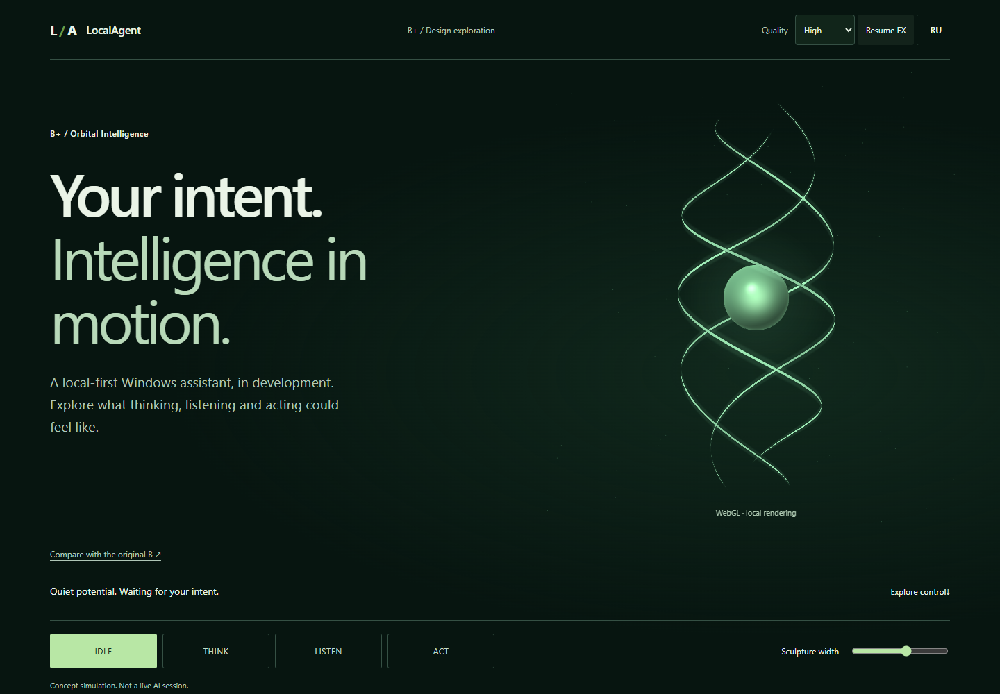

# B+ · Orbital Intelligence / Vertical signal sculpture

Owner refinement of B from PR #18. **Not an approved production redesign.** Issues #13–17 remain blocked. This branch is stacked on `feature/site-v3-design-explorations` (`197802b`), preserving A/B/C.

## View it

On the owner's current computer: **http://127.0.0.1:8772/experiments/site-v3/concept-bplus/** (temporary loopback preview, bounded server lifetime). The running preview is opened in Codex. Use the on-page “Compare with the original B” link for direct before/after interaction.

For a fresh checkout, double-click [start-preview.cmd](start-preview.cmd) on Windows with Python installed, or run from the repository root:

```sh
python experiments/site-v3/preview.py --concept bplus --open --minutes 60
```

The default runner uses port 8770; specify `--port 8772` if needed. The server binds only 127.0.0.1, auto-expires, and can be stopped with Ctrl+C. A public `/preview/` URL still shows the existing site. **No public or private remote publication was performed.** A safe remote-review alternative would be a separate static host/artifact containing only the experiments, with no Pages or stable-site integration; publishing that requires separate owner permission. No tunnel is created.

## Art direction

The owner's clarification supersedes a sphere-with-rings composition: the principal silhouette is a **slender vertical helical sculpture**, with three fine ribbons wrapping a small luminous center. The core supports the silhouette rather than becoming a large ordinary orb. Ribbon width tapers deliberately at the endpoints; three phase offsets, subtly different tilts and a restrained particle field communicate depth. No straight central beam or screen-wide bloom.

The B typography and atmosphere are retained with a calmer sans-serif treatment, forest-green background, sage text and controlled mint light. THINK bends the helical path and increases flow; LISTEN applies synchronized radial waves without a microphone; ACT tightens directional flow; IDLE remains slow and quiet. Palette changes are secondary to geometry/motion changes. All remain simulations.

## Implementation

- Original WebGL2 indexed triangle meshes: UV core sphere + continuous parameter-space ribbon strips. No new runtime dependencies, Three.js, GSAP, textures or remote APIs.
- Actual perspective/depth buffer: the solid core occludes the rear ribbon sections. Opaque ribbon pass writes depth; a low-opacity, depth-tested expanded ribbon pass adds a local halo. Hardware MSAA requested and actual context antialias status recorded. `preserveDrawingBuffer:false`.
- High: 96×64 sphere, 420 segments per ribbon, 100 secondary points, DPR <=2, buffer <=2.15M pixels, target 60 render submissions/sec.
- Balanced: 48×32 sphere, 180 ribbon segments, 45 points, DPR <=1.25, buffer <=0.95M pixels, target 30 submissions/sec.
- Lite: original static SVG helix/core, no render loop. Initial profile adapts to viewport and reported hardware; manual quality selection is always available. This is not a thermal-adaptive governor.
- Delta time drives the simulation; velocity is integrated into phase rather than multiplying absolute time by a changing speed. Exponential state and pointer interpolation avoids phase jumps. Per-frame values reuse typed buffers; query objects are allocated only for occasional GPU timing samples and are deleted when consumed.
- Pause, reduced motion, hidden document and offscreen scene suspend the loop. Resize caps buffer dimensions. Context loss displays the SVG and context restoration rebuilds buffers/program. Resource disposal covers non-BFCache navigation; BFCache restores resume safely.
- GPU timing uses asynchronous `EXT_disjoint_timer_query_webgl2`; disjoint results are discarded. Unsupported devices report no GPU measurement instead of substituting CPU time. Public `canvas.orbitalMetrics()` returns bounded sample summaries for inspection.

## Review response (PR #18)

| Finding | Action / evidence |
|---|---|
| P1: experiment files never trigger CI | New **PR-only** `site-v3-experiments.yml`: contents:read, 10-minute job bound, syntax/unit/build checks and 3-minute WebGL browser smoke. Its name cannot trigger the existing Pages workflow. No Pages/deploy permissions, no production workflow edits. |
| P2: unfinished A/C raymarch treated as hit | Shared shader now requires an explicit convergence flag; exhausted marches are transparent. B+ uses meshes and has no raymarch hit classification. A/C smoke and oblique captures remain included. |
| P2: AA/frame pacing not demonstrated | B+ MSAA, no preserved drawing buffer, 60/30 pacing, GPU/CPU/frame samples below. No claim of production-wide optimization. |
| Owner review friction | Direct opened local B+ URL, on-page original-B link, one-click launcher and bounded runner. Remote deployment remains permission-gated. |
| Visual originality / owner boundary | Vertical helix implements the owner's latest clarification; screenshots and video support inspection. **No automated visual sign-off is claimed.** |

## Verified results

`npm run build` passes **21 tests** (including sphere geometry, helix topology and buffer policy). Local CI-equivalent smoke passes A/C WebGL, B+ profiles, modes, reduced motion and mobile overflow. Full QA callback: [qa.js](qa.js), run with Playwright CLI from the repository root against port 8772.

Chrome: all 360/390/430/768/1440/1920 × EN/RU; four mode buttons; High/Balanced/Lite; keyboard mode/range controls; separate touch context; manual pause and reduced-motion render-count stability; offscreen suspension; forced no-WebGL2, low-power, no-JS; context loss **and restoration**. No page errors or failed HTTP responses in the matrix. Microsoft Edge: four states, WebGL2 and desktop/mobile overflow smoke. Firefox/Safari and physical phones were not tested.

Chrome DevTools: all scene resources local, no console warnings/errors; mobile Lighthouse accessibility 100 / best practices 100 after fixing the quality selector's accessible name. SEO noindex is intentional. A separate 5-second DevTools trace observed CLS 0.00; it is not used as a substitute for GPU timing.

### Measured motion (1440×1000, RTX 3090 Ti, Windows ANGLE/D3D11)

Each Chrome state/profile sample lasts 5.5 seconds. Raw results: [chrome.json](evidence/chrome.json), [edge.json](evidence/edge.json). Values rounded below.

| Profile / browser | Render FPS | Frame interval p95 | CPU submit p95 | GPU render p95 |
|---|---:|---:|---:|---:|
| Chrome High, all 4 states | 59.96 | 16.7–16.8 ms | 0.10 ms | 0.080–0.097 ms |
| Chrome Balanced, all 4 | 29.98 | 33.4 ms | 0.10 ms | 0.049–0.073 ms |
| Edge High, short mixed-state sample | 58.45 | 16.8 ms | 0.10 ms | 0.050 ms |

The desktop samples used a 456,300-pixel buffer and confirmed MSAA enabled. GPU queries time this scene's submitted draw work, not the browser compositor or display latency. Samples on a high-end GPU do not establish low-end, battery or sustained thermal performance. Frame p95 describes intervals between submitted frames, not CPU processing duration. Initial uncapped 180Hz behavior was found and corrected before the final Chrome samples.

## Visual evidence

| View | Image |
|---|---|
| Desktop 1440 / 1920 | [1440](evidence/1440-en.png) / [1920](evidence/1920-en.png) |
| Mobile 390 / 430 / RU | [390](evidence/390-en.png) / [430](evidence/430-en.png) / [RU](evidence/390-ru.png) |
| IDLE / THINK / LISTEN / ACT | [0](evidence/state-0.png) / [1](evidence/state-1.png) / [2](evidence/state-2.png) / [3](evidence/state-3.png) |
| Static helix fallback | [SVG render](evidence/fallback.png) |
| A/C after convergence fix | [A oblique](evidence/a-oblique.png) / [C oblique](evidence/c-oblique.png) |
| Recorded motion | [MP4, real 60fps capture](evidence/motion.mp4) |



## Remaining limitations / gate

Thin endpoint tapers intentionally fade, particularly in Balanced/Lite. Hardware MSAA availability varies; no postprocess AA or full-scene bloom is added. Visual acceptance of the sculpture, long-duration thermals, screen readers and cross-engine testing remain open. The original A/B/C screenshots and their old performance reports remain historical evidence; this directory documents the new B+ measurements.

Everything stays in experiments except the explicitly requested isolated CI workflow. Production HTML/CSS/JS, build allow-list, Pages settings, main and the deployed develop site are unchanged. No merge is authorized. Owner should approve this specific B+ PR/SHA or request visual revisions before #13–17.
